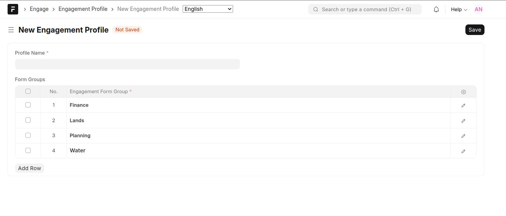

==================
Engagement Profile
==================

This feature allows grouping of different engagement tools for ease of assignment of :doc:`permissions <assign-form-permissions>`.

- A profile is a collection of multiple form group types to ensure that forms designed by a group of users, e.g users in one department, that these forms are only accessible by these users and invisible to the rest of the users

See :doc:`Assign Form Permissions <assign-form-permissions>`.

