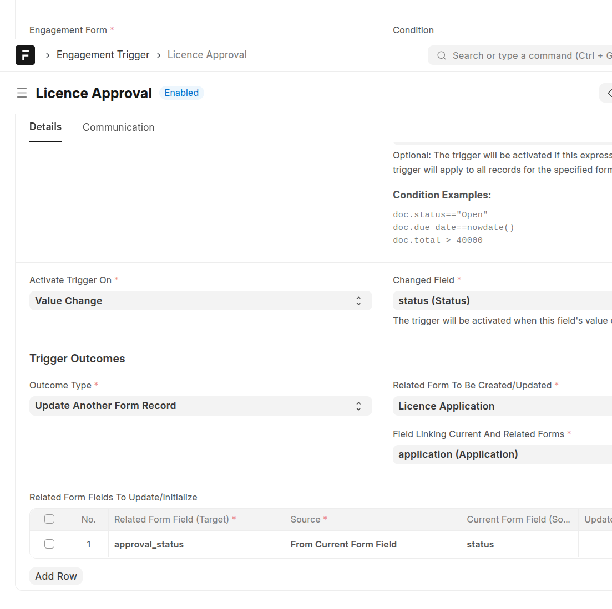
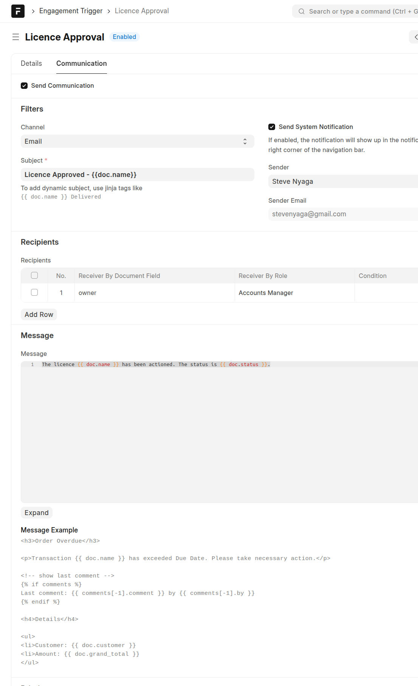

===================
Engagement Triggers
===================

General Details
===============

Triggers are a means of triggering actions within the platform that arise due to changes in data. Whenever a specific piece of data changes, an action can be triggered when certain conditions are met. 

An engagement trigger can be used to notify internal system users whenever certain data is captured into the system. For example, whenever a grievance is raised, the system can send a notification to the appropriate officer for action.

- **Trigger Name**. This is the unique name that will identify a trigger
- **Engagement Form**. This is the engagement form that is associated with this trigger. In other words, this trigger is activated when records of this engagement form are captured or edited
- **Enabled**. Determines if the trigger is active or not. Only enabled triggers will fire
- **Condition**. The trigger will be activated if this expression is true. If left blank, the trigger will apply to all records for the specified form. It acts as a filter to ensure the trigger is activated on different conditions. For example, it may be that different officers are assigned  grievances for different geographical regions. So one would want to trigger an action when specific grievances are registered. 

.. code-block:: python

    doc.status=="Open" or doc.country == 'Kenya'
    doc.due_date==nowdate()
    doc.total > 40000 and doc.status == 'Approved'

- **Activate Trigger On**. A trigger can be activated in the following ways:

    - **New**. This activates when a new record is captured
    - **Value Change**. This activates whenever the value of a field changes.  
    - **Changed Field**. This is the field whose changes will be listened to when the value of Activate Trigger On is set as Value Change.

- **Outcome Type**. This defines the type of outcome when a trigger is activated. The possible values are:

    - **Update Current Record**. When a trigger is activated, specific fields within the triggering record will be updated with the specified values. These fields are defined in the *Set Property After Trigger* table
    - **Create Another Form Record**. When a trigger is activated, a new record of the specified *Related Form* will be generated. The values of this new generated record can either be copied from the triggering document or they can be absolute values. The user does not need to specify all the fields for the resulting form, but rather only the fields whose values need to be initialized.
    - **Update Another Form Record**. When a trigger is activated, an existing record of a different engagement form will be updated with the values specified in the *Related Form Fields To Update/Initialize* table. Values to be used to update the existing record can either be copied from the triggering record or specific hard coded values.

- **Related Form To Be Created/Updated**. This is a form whose a record will be created or updated if the outcome type is set as *Create Another Form Record* or *Update Another Form Record*
- **Field Linking Current And Related Forms**. This property specifies the link between the triggering form record and the related form record that will be updated. It is used to join data for the triggering form and the resulting form. This must be a **Link** field existing in the triggering **Engagement Form** and whose form is set as the value of the **Engagement Form** field.

Communication
=============

- Sometimes, activating a trigger may lead to sending of an email or an SMS to specific recipients. 

- **Send Communication**. When checked, an email/SMS/System Notification will be sent to specific recipients whenever this trigger is activated
- **Channel**. This determines the type of notification to be sent.

    - **Email**. For emails, make sure that an email account has been configured to facilitate sending of emails
    - **SMS**. Make sure that SMS configuration has been done in the SMS settings
    - **System Notification**. The notification will show up in the notifications dropdown on the top right corner of the navigation bar. 

- **Subject**. This will be heading of the message being communicated. If you need a dynamic subject, make use of Jinja tags e.g *{{ doc.name }}*. The *name* here refers to a field in the referenced Engagement Form
- **Send System Notification**. If enabled, the notification will show up in the notifications dropdown on the top right corner of the navigation bar. This enables sending of a system notification in addition to another channel e.g email or SMS
- **Sender**. This is the email account that will be used to send the email
- **Recipients**. This specifies the different type of recipients to whom a communication will be made.

    - **Receiver by Document Field**. This retrieves fields within the referenced Engagement Form that contain email addresses of phone numbers. 
    
    .. note:: 

        - When the channel is Email, only Engagement Form fields whose type is **Data** and that have **Email** specified as Special Text Validation will be used. 
        
        - When the channel is SMS, only fields whose type is **Data** and that have **Phone** specified as Special Text Validation will be used. 

    - **Receiver By Role**. When a role is selected, all the users belonging to the selected role will receive communication
    - **Condition**. If you want emails sent to different recipients depending on specific conditions, set the expression here. The expression is set as a Python expression e.g
    
    .. code-block:: python
        
        doc.total <= 1000000 or doc.status == 'Pending'

- **Message**. This is the body of the message that will be sent to recipients. If you need to add a dynamic message, use Jinja template tags. e.g 

.. code-block:: markdown
    
    The licence {{ doc.name }} has been actioned. The status is {{ doc.status }}.

- **Attach Print**. If you need to include a PDF attachment of the triggering record, then ensure this is checked. 
- **Print Format**. If you need to include a specific print format for the referenced engagement form, then select the appropriate Print Format, else the default print format will be used
